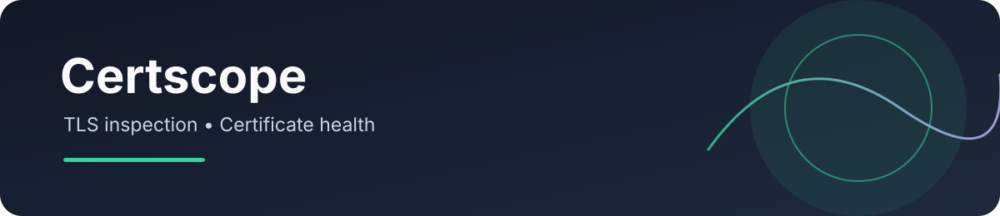

# CertScope

<p align="center"></p>

A TLS certificate inspector for domains and services you own or administer. Uses Python's standard `ssl` and `socket` modules.

## Reports
- Certificate subject and issuer
- Expiration timestamp and days remaining
- Hostname verification through the platform trust store
- Subject Alternative Names and SHA-256 fingerprint
- Human-readable output or JSON for scripts and CI

## Run
Python 3.9+; no dependencies:

```bash
python app.py example.com
python app.py example.com:8443 --json
python app.py example.com example.org --timeout 10
```

Exit code is non-zero if a connection fails or a certificate is expired. Certificate validation is not bypassed.